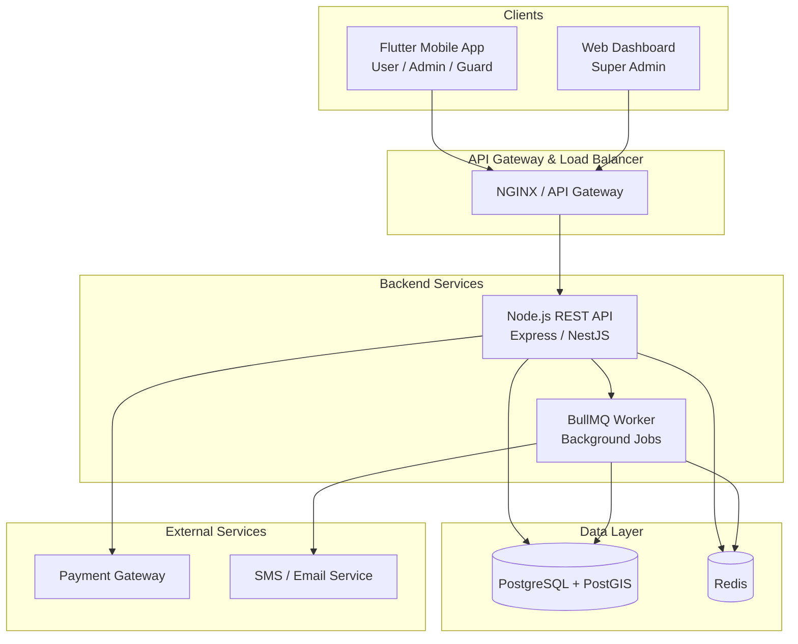
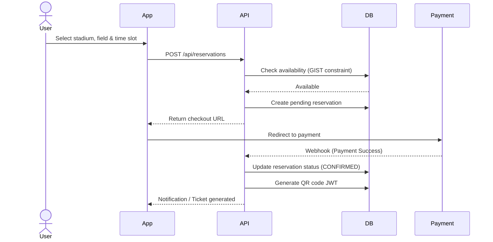

# System Architecture

## High-Level Architecture

The Stadium Reservation Platform follows a modern client-server architecture with a mobile-first approach.



## Component Architecture

```mermaid
componentDiagram
    package "Frontend (Flutter)" {
        [Auth Module]
        [Booking Module]
        [Subscription Module]
        [QR Scanner Module]
    }
    
    package "Backend (Node.js)" {
        [Auth Controller]
        [Reservation Controller]
        [Stadium Controller]
        [Payment Webhook]
    }

    [Auth Module] --> [Auth Controller]
    [Booking Module] --> [Reservation Controller]
    [Subscription Module] --> [Payment Webhook]
```

## Technology Stack

- **Frontend:** Flutter (iOS/Android), Dart
- **Backend API:** Node.js, TypeScript, Express/NestJS
- **Database:** PostgreSQL 15+ with PostGIS extension for spatial queries (Sétif bounds)
- **Caching & Message Queue:** Redis, BullMQ
- **Authentication:** JWT (JSON Web Tokens), Argon2id for password hashing
- **Deployment:** Docker, Docker Compose, Linux VPS

## Data Flow: Reservation Process



## Module Structure
- **Users & Auth:** Handles registration, login, JWT issuance, RBAC.
- **Stadiums & Fields:** Manages hierarchy (Wilaya -> Commune -> Stadium -> Field).
- **Reservations & Subscriptions:** Core booking logic, conflict prevention (EXCLUDE USING GIST), 1-hour chunks.
- **Payments:** Webhook handlers for finalizing transactions.
- **Background Jobs:** Handling 15-day grace periods, releasing unpaid holds, materialized subscription generation.
