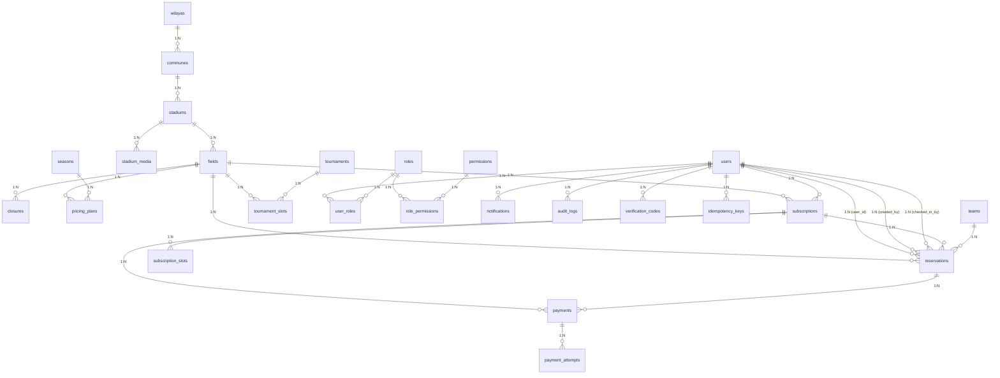

# Database and API Mapping — Stadium Platform Sétif

**Audit date:** 2026-10-22  
**Source:** Static inspection of `database/schema.sql`, `database/seed/`, backend source code, admin source code, and mobile source code. No live database was contacted.

---

## 1. Schema Inventory (24 Tables)

| # | Table | PK Type | Purpose | Row Deletion Policy |
|---|---|---|---|---|
| 1 | `wilayas` | UUID | Geographic regions (provinces) | RESTRICT |
| 2 | `communes` | UUID | Sub-regions within wilayas | RESTRICT |
| 3 | `users` | UUID | All platform users | CHECK: phone OR email required |
| 4 | `roles` | UUID | Named roles (CITIZEN, GUARD, ADMIN, SUPER_ADMIN) | CASCADE |
| 5 | `user_roles` | Composite (user_id, role_id) | Many-to-many user↔role | CASCADE both sides |
| 6 | `permissions` | UUID | Named permissions | CASCADE |
| 7 | `role_permissions` | Composite (role_id, permission_id) | Many-to-many role↔permission | CASCADE both sides |
| 8 | `verification_codes` | UUID | OTP codes (hashed) with expiry and attempt tracking | CASCADE on user delete |
| 9 | `stadiums` | UUID | Sports stadiums with PostGIS location | RESTRICT on commune |
| 10 | `stadium_media` | UUID | Media files for stadiums (S3 URLs) | CASCADE on stadium |
| 11 | `fields` | UUID | Playing fields within stadiums | CASCADE on stadium |
| 12 | `seasons` | UUID | Sporting seasons (Sep–Jul) | — |
| 13 | `pricing_plans` | UUID | Price per field/season/coverage/duration | UNIQUE constraint |
| 14 | `teams` | UUID | Admin-created teams (1–3 sessions/week) | CHECK constraint on duration |
| 15 | `subscriptions` | UUID | Recurring booking subscriptions | RESTRICT on user/field/pricing |
| 16 | `subscription_slots` | UUID | Weekday+time slots for subscriptions | CASCADE on subscription |
| 17 | `reservations` | UUID | Individual booking slots | GIST exclusion constraint |
| 18 | `tournaments` | UUID | Tournament events | — |
| 19 | `tournament_slots` | UUID | Time slots blocked by tournaments | CASCADE on tournament |
| 20 | `closures` | UUID | Field closure periods | CASCADE on field |
| 21 | `payments` | UUID | Payment records (reservation XOR subscription) | CHECK constraint |
| 22 | `payment_attempts` | UUID | Individual payment processing attempts | CASCADE on payment |
| 23 | `idempotency_keys` | UUID | Prevent duplicate API operations | CASCADE on user |
| 24 | `notifications` | UUID | User notifications (trilingual) | CASCADE on user |
| 25 | `audit_logs` | UUID | Administrative action audit trail | SET NULL on user |

---

## 2. Entity Relationship Map

---

## 3. Enum Mapping (Database ↔ Backend ↔ Frontend)

| Enum | Database Type | Backend Enum | Admin Type | Mobile | Aligned? |
|---|---|---|---|---|---|
| verification_type | `PHONE, EMAIL, PASSWORD_RESET` | `VerificationCodeType` | — | — | ✅ |
| booking_mode | `FULL_ONLY, FULL_AND_HALF` | `BookingMode` | `BookingMode` | — | ✅ |
| season_status | `PLANNED, ACTIVE, CLOSED` | `SeasonStatus` | — | — | ✅ |
| field_coverage | `FULL, HALF_A, HALF_B` | `CoverageType` | `CoverageType` | — | ✅ |
| duration_type | `SINGLE, MONTHLY, THREE_MONTHS, SIX_MONTHS, YEARLY` | `DurationType` | — | — | ✅ |
| subscription_status | `ACTIVE, EXPIRED, CANCELLED` | `SubscriptionStatus` | in Subscription type | — | ✅ |
| reservation_type | `SINGLE, SUBSCRIPTION, TEAM` | `ReservationType` | in Reservation type | — | ✅ |
| reservation_status | `PENDING_PAYMENT, CONFIRMED, CANCELLED, EXPIRED, CHECKED_IN, COMPLETED` | `ReservationStatus` | `ReservationStatus` | — | ✅ |
| closure_reason | `maintenance, works, technical_problem, event, administrative_decision, other` | `ClosureReason` | hardcoded options | — | ✅ |
| payment_status | `PENDING, PROCESSING, PAID, FAILED, CANCELLED, REFUNDED` | `PaymentStatus` | `PaymentStatus` | — | ✅ |

**Assessment: All enum values are fully aligned across database, backend, and admin frontend.**

---

## 4. API Endpoint Inventory

### Auth (`/api/v1/auth/`)
| Method | Path | Auth | Role | Controller |
|---|---|---|---|---|
| POST | `/register` | Public | — | `auth.controller.ts` |
| POST | `/login` | Public | — | `auth.controller.ts` |
| POST | `/verify-otp` | Public | — | `auth.controller.ts` |
| POST | `/refresh` | JwtRefreshGuard | — | `auth.controller.ts` |
| POST | `/logout` | JWT | — | `auth.controller.ts` |

### Users (`/api/v1/users/`)
| Method | Path | Auth | Role | Issue |
|---|---|---|---|---|
| GET | `/profile` | JWT | — | Uses `req.user.sub` |
| GET | `/` | JWT | `'admin'` ⚠️ | **Lowercase role string** |
| GET | `/:id` | JWT | `'admin'` ⚠️ | **Lowercase role string** |
| POST | `/` | JWT | `'admin'` ⚠️ | **Lowercase role string** |
| PUT | `/:id` | JWT | `'admin'` ⚠️ | **Lowercase role string** |
| PATCH | `/:id/toggle-active` | JWT | `'admin'` ⚠️ | **Lowercase role string** |

### Stadiums (`/api/v1/stadiums/`)
| Method | Path | Auth | Permission |
|---|---|---|---|
| GET | `/` | Public | — |
| GET | `/:id` | Public | — |
| POST | `/` | JWT | MANAGE_STADIUMS |
| PUT | `/:id` | JWT | MANAGE_STADIUMS |
| PATCH | `/:id/toggle-active` | JWT | MANAGE_STADIUMS |

### Fields (`/api/v1/fields/`)
| Method | Path | Auth | Permission |
|---|---|---|---|
| GET | `/?stadium_id=` | Public | — |
| GET | `/:id` | Public | — |
| POST | `/` | JWT | MANAGE_FIELDS |
| PUT | `/:id` | JWT | MANAGE_FIELDS |
| PATCH | `/:id/toggle-active` | JWT | MANAGE_FIELDS |

### Reservations (`/api/v1/reservations/`)
| Method | Path | Auth | Role |
|---|---|---|---|
| GET | `/mine` | JWT | — |
| GET | `/` | JWT | ADMIN |
| POST | `/` | JWT | — |
| DELETE | `/:id/cancel` | JWT | — |

### Availability (`/api/v1/availability/`)
| Method | Path | Auth |
|---|---|---|
| GET | `/?field_id=&date=` | JWT |

### Subscriptions (`/api/v1/subscriptions/`)
| Method | Path | Auth | Note |
|---|---|---|---|
| POST | `/` | JWT | Creates subscription for current user |
| GET | `/` | JWT | **User-scoped only — no admin listing** |
| DELETE | `/:id/cancel` | JWT | Owner-scoped cancellation |

### Payments (`/api/v1/payments/`)
| Method | Path | Auth | Role |
|---|---|---|---|
| POST | `/` | JWT | — |
| POST | `/webhook` | Public | — |
| GET | `/` | JWT | ADMIN |
| GET | `/stats` | JWT | ADMIN |
| GET | `/:id` | JWT | ADMIN |

### Check-in (`/api/v1/check-in/`)
| Method | Path | Auth | Role/Permission |
|---|---|---|---|
| POST | `/qr` | JWT | CITIZEN |
| POST | `/scan` | JWT | GUARD + SCAN_RESERVATION + CHECK_IN |

### Other endpoints
| Module | Method | Path | Auth | Role |
|---|---|---|---|---|
| Teams | POST | `/teams` | JWT | ADMIN |
| Tournaments | POST | `/tournaments` | JWT | ADMIN |
| Closures | POST | `/closures` | JWT | ADMIN |
| Closures | GET | `/closures` | JWT | ADMIN |
| Pricing | GET | `/pricing` | JWT | — |
| Seasons | GET | `/seasons` | JWT | — |
| Audit | GET | `/audit` | JWT | `'admin'` ⚠️ |
| Health | GET | `/health`, `/live`, `/ready` | — | — |

---

## 5. Frontend-to-API-to-Database Field Mappings

### Admin StadiumsPage → `GET /stadiums` → `stadiums` table

| UI Field | API Response Field | DB Column | Type | Validated |
|---|---|---|---|---|
| Stade (name) | `name_fr` | `stadiums.name_fr` | VARCHAR | ✅ |
| Commune | `commune_name` | `communes.name_fr` (JOIN) | VARCHAR | ✅ |
| Adresse | `address` | `stadiums.address` | VARCHAR | ✅ |
| Terrains count | `fields_count` | COUNT(fields) | computed | ✅ |
| État | `is_active` | `stadiums.is_active` | BOOLEAN | ✅ |
| ID | `id` | `stadiums.id` | UUID | ✅ |
| commune_id | `commune_id` | `stadiums.commune_id` | UUID FK | ✅ |

### Admin ReservationsPage → `GET /reservations` → `reservations` table

| UI Field | API Response Field | DB Column | Type | Concern |
|---|---|---|---|---|
| Usager | `user_name` | `users.first_name + last_name` (JOIN) | computed | — |
| Stade | `stadium_name` | `stadiums.name_fr` (JOIN) | computed | — |
| Terrain | `field_name` | `fields.name_fr` (JOIN) | computed | — |
| Couverture | `coverage` | `reservations.coverage` | field_coverage enum | ✅ |
| Type | `type` | `reservations.type` | reservation_type enum | ✅ |
| Créneau | `starts_at`, `ends_at` | `reservations.starts_at/ends_at` | TIMESTAMPTZ | ✅ |
| Statut | `status` | `reservations.status` | reservation_status enum | ✅ |
| ID | `id` | `reservations.id` | UUID | ✅ |

**⚠️ Response envelope concern:** Page expects flat `ReservationRow[]`. Repository may return paginated `{ data, total }`.

### Admin PaymentsPage → `GET /payments` → `payments` table

| UI Field | API Response Field | DB Column | Type |
|---|---|---|---|
| ID | `id` | `payments.id` | UUID |
| Cible | `reservation_id` / `subscription_id` | FK columns | UUID |
| Transaction provider | `provider_transaction_id` | `payments.provider_transaction_id` | VARCHAR |
| Date | `created_at` | `payments.created_at` | TIMESTAMPTZ |
| Statut | `status` | `payments.status` | payment_status enum |
| Montant | `amount` | `payments.amount` | NUMERIC(12,2) |
| Devise | `currency` | `payments.currency` | VARCHAR (default 'DZD') |

---

## 6. Date/Time and Currency Handling

- **Database:** All timestamps are `TIMESTAMPTZ` (timezone-aware). Dates use `DATE` type.
- **Backend:** JavaScript `Date` objects. UTC comparison for August break check (`getUTCMonth() === 7`).
- **Admin:** `new Date(value).toLocaleString('fr-DZ')` for display.
- **Currency:** `NUMERIC(12,2)` in DB, `DZD` default. Admin displays `amount currency` string.
- **Concern:** No explicit timezone conversion in backend reservation creation. `starts_at` is parsed directly from ISO string.

---

## 7. Schema/API Mismatches Found

| ID | Mismatch | Severity | Detail |
|---|---|---|---|
| MAP-01 | Reservations response format | MEDIUM | Admin expects flat array; backend may paginate |
| MAP-02 | Payments response format | MEDIUM | Admin expects flat array; backend `getPayments()` format unknown |
| MAP-03 | Users profile `sub` vs `id` | MEDIUM | `getProfile` uses `req.user.sub`, others use `req.user.id` |
| MAP-04 | Role string case | CRITICAL | `'admin'` vs `'ADMIN'` in decorators |
| MAP-05 | Payment DTO ignored | MEDIUM | `createPayment()` receives DTO but ignores it |
| MAP-06 | No admin subscription listing | HIGH | Frontend correctly blocked but backend gap remains |
