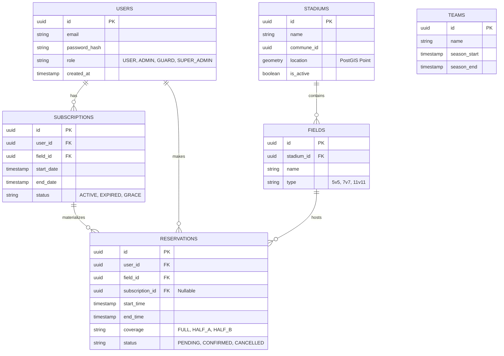

# Database Documentation

## Entity-Relationship Diagram



## Table Descriptions
- **Users**: Core identity table. Roles determine access levels. Password uses Argon2id.
- **Stadiums**: Physical locations. Requires PostGIS to validate bounds within Sétif.
- **Fields**: Sub-units of a stadium. Can be split into A/B for reservations.
- **Subscriptions**: Long-term recurring bookings.
- **Reservations**: The single source of truth for time slots. Contains both one-off bookings and materialized subscription slots.

## Key Constraints & GIST

To absolutely prevent double-booking, the `reservations` table utilizes PostgreSQL `EXCLUDE USING GIST`.

```sql
ALTER TABLE reservations
ADD CONSTRAINT prevent_overlapping_reservations
EXCLUDE USING GIST (
    field_id WITH =,
    tsrange(start_time, end_time) WITH &&
)
WHERE (status IN ('CONFIRMED', 'PENDING'));
```
*Note: The actual implementation will include logic to handle `FULL`, `HALF_A`, and `HALF_B` overlap via custom functions or mapping logic in the constraint.*

## Migration Strategy
- Migrations will be handled via Node.js migration tools (e.g., Knex or TypeORM migrations).
- PostGIS must be installed and initialized (`CREATE EXTENSION postgis;`) before the first schema migration.
- All primary keys are UUIDs, requiring `CREATE EXTENSION "uuid-ossp";`.
